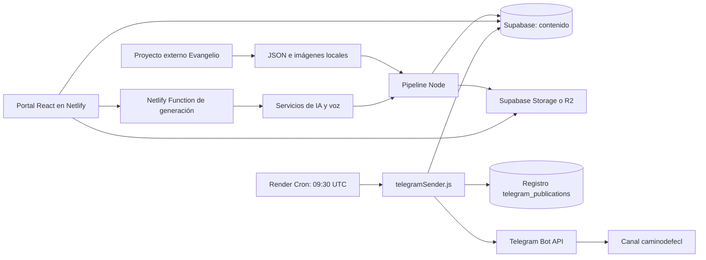
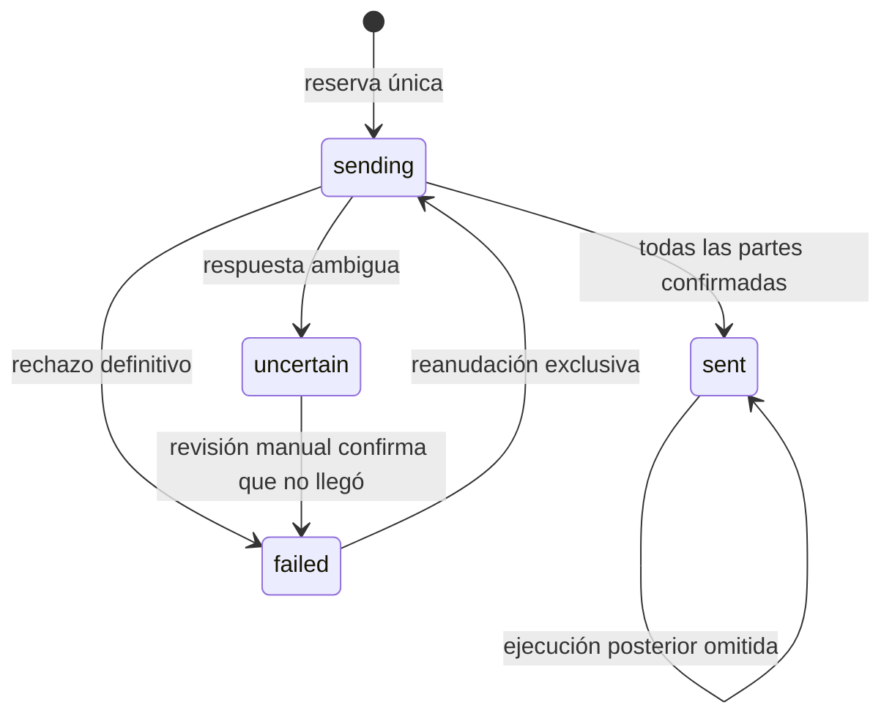

# SDD — Camino de Fe

Especificación general para desarrollo guiado por especificaciones (*Spec Driven Development*).

| Campo | Valor |
| --- | --- |
| Versión | 1.0 |
| Fecha de revisión | 2026-10-06 |
| Proyecto | `webSiteCatolico` / Camino de Fe |
| Base examinada | Código local sobre `0e29065`, configuración y pruebas de Telegram realizadas en esta sesión |
| Estado | Línea base documentada; mejoras propuestas pendientes de implementación |

## 1. Propósito y alcance

Camino de Fe ofrece recursos católicos en español: evangelio, lecturas, santo del día, reflexiones, oraciones, audios y ayudas para rezar. El sistema prepara contenido, lo almacena y lo presenta en la web; un cron independiente publica el evangelio y la oración en Telegram.

Esta SDD define requisitos identificables, diseño, contratos, criterios de aceptación y evolución. No certifica que todas las funcionalidades estén probadas en producción. **SDD es también una forma de trabajar:** cada cambio debe partir de una especificación y terminar con evidencia de sus criterios de aceptación.

Existe una especificación anterior, [SPEC_AUTOMATIZACION_CONTENIDO.md](SPEC_AUTOMATIZACION_CONTENIDO.md), dedicada al pipeline y con historial de ejecuciones. Se conserva como documento de detalle. Para la distribución actual prevalece [TELEGRAM_RENDER.md](TELEGRAM_RENDER.md); las descripciones de WhatsApp de documentos anteriores son históricas.

Fuera del alcance actual: aplicaciones móviles nativas, pagos, importación automática de teléfonos a Telegram, chat conversacional con el bot y generación de contenido dentro del cron de envío.

## 2. Evidencia y estados

Se distinguen tres estados:

- **Implementado:** existe código que soporta el comportamiento; no equivale a validación integral en producción.
- **Verificado:** comportamiento comprobado y evidencia indicada.
- **Pendiente:** propuesta o brecha; no se presenta como funcionalidad terminada.

| Área | Estado observado | Fuente |
| --- | --- | --- |
| Portal React y rutas públicas | Implementado | `src/App.tsx`, `src/pages/` |
| Pipeline de importación y sincronización | Implementado; historial de ejecución en la spec específica | `scripts/contentPipeline.js`, `scripts/lib/contentPipeline/` |
| Telegram en Render | Verificado el 2026-10-06: cuatro mensajes y repetición sin duplicados | `docs/TELEGRAM_RENDER.md`, logs de Render de esta sesión |
| Registro privado de publicaciones | Migración aplicada y acceso de servidor verificado | `supabase/migrations/20261005163859_create_telegram_publications.sql` |
| Panel administrativo | Demo local; no autenticación administrativa de producción | `src/components/Admin/ProtectedRoute.tsx` |
| Formulario de contacto | Simula éxito con un temporizador; no entrega real | `src/pages/Contact.tsx` |
| Blog | Retirado; `/blog/*` redirige a inicio | `src/App.tsx` |
| Despliegue web actual en Netlify | Configuración presente; publicación de la última versión no verificada en esta revisión | `netlify.toml` |

La revisión no accedió de nuevo a la base remota ni auditó todas sus políticas. El inventario de tablas se deriva del repositorio, salvo la migración Telegram ya comprobada durante su activación.

## 3. Usuarios y responsabilidades

| Actor | Necesidad | Responsabilidad o límite |
| --- | --- | --- |
| Visitante | Leer y escuchar contenido, usar recursos de oración | Acceso público a las páginas |
| Miembro del canal | Recibir publicaciones diarias | Unirse voluntariamente a `@caminodefecl` |
| Editor u operador | Preparar, revisar y publicar contenido | Ejecutar pipeline y revisar resultados; no asumir disponible el panel productivo |
| Operador técnico | Mantener configuración, cron y recuperación | Gestionar secretos, migraciones y fallos de entrega |
| Bot | Publicar en el canal | Administrador con permiso para publicar; no gestiona suscriptores por teléfono |

## 4. Requisitos funcionales y aceptación

Los criterios siguientes son verificables. Donde se indica una brecha, expresan el comportamiento requerido para dar por terminada esa área.

| ID | Requisito | Criterio de aceptación | Situación |
| --- | --- | --- | --- |
| RF-01 | Consultar evangelio, lectura y santo por fecha | Mostrar el registro del tipo y fecha solicitados; distinguir contenido ausente de contenido real | Implementado parcialmente: existe fallback estático que debe diferenciarse mejor |
| RF-02 | Reproducir audios disponibles | Evangelio, reflexión y oración reproducen su archivo; la ausencia no impide leer | UI implementada; prueba funcional pendiente en producción |
| RF-03 | Ofrecer recursos de oración | Acceso a oraciones, novenas, rosario y calendario por sus rutas | Implementado; revisión completa de navegación pendiente |
| RF-04 | Gestionar peticiones de oración | Crear, listar e incrementar contador con persistencia y errores visibles | Servicio implementado; permisos y abuso pendientes de auditoría |
| RF-05 | Preparar contenido por fecha o rango | Importar y validar archivos; sincronizar por `(date,type)`; informar faltantes y errores | Implementado; detalle en spec del pipeline |
| RF-06 | Simular preparación sin escritura | `--dry-run` informa acciones sin publicar ni enviar | Modo implementado; comprobarlo en cada cambio del pipeline |
| RF-07 | Publicar diariamente en Telegram | Con contenido válido, publicar textos y medios disponibles y terminar con `sent` | Verificado: 2026-10-06, cuatro mensajes |
| RF-08 | Evitar duplicación diaria | Segunda ejecución del mismo canal/fecha devuelve `already_sent` y no envía | Verificado en servicio real y cubierto por pruebas |
| RF-09 | Recuperar fallos sin reenvío ciego | Rechazo definitivo reanuda desde la parte pendiente; resultado incierto exige revisión | Implementado y probado con dobles de servicios |
| RF-10 | Invitar al canal desde inicio | Enlace válido abre `https://t.me/caminodefecl`; valor inválido no abre un destino arbitrario | Componente implementado; despliegue web por verificar |
| RF-11 | Mantener retirado WhatsApp | Sin monitor Excel ni workflow de GitHub; funciones heredadas desactivadas y sin programación Netlify | Implementado; Render usa el servicio independiente `telegram/` |
| RF-12 | Administrar con identidad y permisos reales | Sesión válida y autorización en servidor/base; visitante no puede modificar contenido | Pendiente: guardia actual solo admite demo en desarrollo |
| RF-13 | Entregar consultas de contacto | Confirmar éxito solo tras aceptación por el servicio receptor; mostrar fallo si no entrega | Pendiente: actualmente simulado |

### Rutas del portal

Fuente de verdad: `src/App.tsx`.

- Contenido: `/`, `/evangelio-del-dia`, `/lecturas-del-dia`, `/santo-del-dia`.
- Oración: `/oraciones`, `/oraciones/:category`, `/novenas`, `/novenas/:novenaId`, `/aprende-a-rezar`, `/rosario-interactivo`, `/peticiones-oracion`.
- Recursos: `/calendario-liturgico`, `/arte-sacro`, `/santisimo-24h`.
- Información: `/acerca-de`, `/contacto`, `/politica-privacidad`, `/terminos-condiciones`, `/politica-cookies`.
- Administración: `/admin/login`, `/admin`, `/admin/dashboard`, `/admin/content`, `/admin/settings`.

## 5. Arquitectura



| Capa | Implementación | Observaciones |
| --- | --- | --- |
| Web | React 18, TypeScript, Vite 5, React Router, Tailwind | Versiones declaradas en `package.json`; lockfile determina resolución |
| Datos de cliente | `src/services/supabase.ts`, hooks y servicios | Clave pública y políticas RLS deben limitar operaciones |
| Preparación | Scripts Node, importador externo y sincronización | Puede generar reflexión y voz según modo/configuración |
| Funciones web | `netlify/functions/generate-reflection.ts` | POST; tipos `reflection` y `prayer`; requiere `GEMINI_API_KEY` |
| Distribución | Node 22 en Render, script CommonJS sin dependencias npm | Lee contenido ya preparado; no requiere Excel ni generación IA |
| Medios | URLs de Supabase Storage/R2 y archivos públicos | Deben ser accesibles por el consumidor correspondiente |
| Servidor auxiliar | `server.js`, puerto 3001 | Endpoint de sincronización sin autenticación implementada; no exponer como API pública |

El frontend desplegado y los scripts de preparación tienen ciclos distintos. Subir contenido a Supabase no publica automáticamente los archivos estáticos locales en Netlify. El cron puede seguir enviando sin que la máquina local esté encendida **si el contenido y los medios ya están disponibles**.

## 6. Contratos y persistencia

### Contenido diario

`daily_content` identifica contenido por `date` y `type` (`gospel`, `reading`, `saint`). Campos usados por la web y el emisor: `title`, `content`, `reference`, `reflection`, `prayer`, `image_url`, URLs de audio, `is_active` y estado de publicación.

Para Telegram debe existir exactamente una fila para la fecha con `type=gospel`, `is_active=true` y `status=published`. Evangelio y oración deben ser textos no vacíos. El emisor no usa contenido estático de emergencia.

Los JSON de importación usan nombres `DDMMYYYY.json` y fecha interna `YYYY-MM-DD`. El evangelio incluye `gospel.text`, referencia y `prayer`; el santo incluye `saint.title` y `saint.text`. El contrato ampliado está en la spec de automatización y sus validadores son `scripts/lib/contentPipeline/validators.js`.

### Registro de entrega Telegram

| Campo | Contrato |
| --- | --- |
| `chat_id`, `date` | Clave primaria compuesta; el emisor usa el ID numérico canónico como texto |
| `status` | `sending`, `failed`, `uncertain`, `sent` |
| `messages` | Plan original no vacío de métodos y payloads, almacenado como JSONB |
| `next_index` | Número de partes confirmadas, entre cero y longitud del plan |
| `message_ids` | IDs confirmados; su longitud coincide con `next_index` |
| Timestamps | Seguimiento de creación y actualización |

La tabla tiene RLS habilitado, sin acceso para `anon`/`authenticated` y con SELECT/INSERT/UPDATE para `service_role`. No contiene un directorio de miembros del canal.

### Otras entidades

Las migraciones incluyen `content_schedule`, `prayer_requests`, `liturgical_calendar`, categorías, etiquetas, relaciones de contenido, plantillas, historial, métricas y configuración. También conservan `admin_users`, sesiones, auditoría y `whatsapp_subscriptions`. Su presencia en SQL no prueba que cada módulo esté activo ni que exista autorización administrativa productiva.

## 7. Flujo de distribución y fallos

1. Determinar la fecha con `America/Santiago`, salvo configuración explícita.
2. Leer y validar el evangelio publicado y construir el plan de mensajes.
3. Verificar canal y permiso de publicación del bot.
4. En `--check`, comprobar lectura del registro y finalizar con `ready` sin escribir.
5. En `--execute`, exigir `TELEGRAM_ENABLED=true` y reservar canal/fecha mediante inserción única.
6. Enviar la foto fija `telegram/assets/Santisimo.png` (salvo desactivación explícita), evangelio, oración y audios disponibles de evangelio y oración. La reflexión y su audio no forman parte del envío actual.
7. Guardar el ID y avance tras cada parte; finalizar con `sent`.



Un fallo al guardar después de enviar puede dejar `sending`; requiere la misma revisión que `uncertain`. No se garantiza una transacción única entre Telegram y Supabase. Se prioriza bloquear reenvíos dudosos.

Los textos se dividen en partes de hasta 4000 unidades UTF-16 sin cortar pares Unicode. Hay separación entre mensajes y reintentos acotados para HTTP 429. Los broadcasts de pago se deshabilitan. Archivos y enlaces deben ser HTTPS; una ruta relativa requiere `TELEGRAM_SITE_URL`. La ausencia de imagen es válida; un archivo presente que Telegram rechaza provoca fallo visible.

## 8. Requisitos no funcionales

| ID | Requisito | Evidencia o validación requerida |
| --- | --- | --- |
| RNF-01 | Secretos únicamente en entorno servidor | Sin token de bot ni `service_role` en bundle web, commits o logs |
| RNF-02 | Acceso mínimo a datos | Auditoría de RLS por tabla y rol; Telegram ya restringido |
| RNF-03 | Entrega observable | Logs con fecha y estado; ledger con avance; sin secretos |
| RNF-04 | Fecha coherente | Pruebas de cambio de día y horario estacional; pendiente unificar web y emisor |
| RNF-05 | Interfaz usable | Verificar móvil/escritorio, teclado, contraste y lectura de errores; sin certificación actual |
| RNF-06 | Mantenimiento reproducible | Versionar código y migraciones; registrar evidencia antes de activar cambios |
| RNF-07 | Costos controlados | Separar envío de generación IA y almacenamiento; revisar planes sin asumir gratuidad total |

No hay objetivos medidos de latencia, disponibilidad ni recuperación en esta línea base. Definirlos antes de prometer un SLA. La política de copias de seguridad y la restauración completa están pendientes de verificación.

## 9. Configuración y operación

| Entorno | Configuración principal |
| --- | --- |
| Navegador | `VITE_SUPABASE_URL`, `VITE_SUPABASE_ANON_KEY`, `VITE_TELEGRAM_CHANNEL_URL` |
| Preparación | `EVANGELIO_PROJECT_PATH`, credenciales servidor Supabase y proveedores necesarios según modo |
| Render | `SUPABASE_URL`, `SUPABASE_SERVICE_ROLE_KEY`, `TELEGRAM_BOT_TOKEN`, `TELEGRAM_CHANNEL_ID`, `TELEGRAM_ENABLED=true`, `TELEGRAM_TIMEZONE=America/Santiago`, `NODE_VERSION=22` |
| Retirada WhatsApp | `WHATSAPP_ENABLED=false`, pipeline con modo WhatsApp `none` |

Render reutiliza `webSiteCatolico`, rama `master`, raíz `telegram`, build `node --check scripts/telegramSender.js`, comando `node scripts/telegramSender.js --execute` y horario `30 09 * * *`. El horario es UTC; la zona de la fecha no modifica la programación.

Netlify usa `npm run build`, publica `dist` y sirve las funciones de `netlify/functions`. El archivo configura Node 18; su compatibilidad y actualización deben revisarse de forma independiente a Node 22 en Render.

La migración Telegram se aplicó mediante SQL Editor. Antes de un futuro `supabase db push`, reconciliar el historial de migraciones remoto; no ejecutar a ciegas todos los SQL existentes.

Ante un fallo: consultar logs y ledger, revisar canal y contenido, corregir la causa y seguir [el procedimiento de recuperación](TELEGRAM_RENDER.md#contenido-y-recuperación). No borrar la fila para forzar un reenvío. La preparación mensual debe completarse antes de agotar los días publicados.

## 10. Validación y trazabilidad

| Validación | Requisitos | Evidencia disponible |
| --- | --- | --- |
| `npm run test:telegram` | RF-07 a RF-09, RNF-01/04 | 11 pruebas aprobadas durante la migración; incluyen concurrencia, Unicode, fallos y reintento |
| `npm run build` | Integración frontend | Build aprobado durante la migración; no prueba despliegue remoto |
| `--check` en Render | RF-07 | `ready`, 2026-10-06, cuatro partes |
| `--execute` en Render | RF-07 | `sent`, cuatro mensajes; ejecución exitosa |
| Segunda ejecución real | RF-08 | `already_sent`, sin nueva publicación |
| Validación de archivos | RF-05/06 | Spec del pipeline registra validación mensual; no repetida al redactar esta SDD |
| Pruebas de panel, contacto y accesibilidad | RF-12/13, RNF-05 | Pendientes |

Comandos desde la raíz, escogiendo únicamente los pertinentes al cambio:

```powershell
npm run build
npm run test:telegram
node --env-file=.env telegram/scripts/telegramSender.js --check
npm run content:pipeline -- --date=2026-10-06 --dry-run
```

`--check` consulta servicios reales sin publicar. Una prueba con `--execute` sí publica y escribe en la base: no usarla como prueba unitaria ni como paso automático de CI.

## 11. Brechas y evolución propuesta

Estas tareas documentan hallazgos; no se implementan por crear esta SDD.

| Prioridad | Tarea | Criterio para cerrarla |
| --- | --- | --- |
| Alta | Unificar fecha y reglas de publicación de la web | El hook deja de depender implícitamente de UTC y se define tratamiento de borradores; coincide con la fecha editorial |
| Alta | Identificar claramente fallback estático | No presentar texto de ejemplo como lectura real del día; prueba con registro ausente |
| Alta | Autenticación y autorización administrativa | Sustituir demo de `localStorage`, validar roles en backend/RLS y probar acceso denegado |
| Alta | Auditar peticiones y generación pública | Revisar exposición de datos, permisos, validación y límites de abuso sin bloquear usos legítimos |
| Media | Completar formulario de contacto | Entrega real y manejo probado de errores |
| Media | Verificar despliegue web tras migración | Enlace Telegram visible en la web publicada y funciones antiguas desactivadas |
| Media | Configurar URL base cuando existan medios relativos | Imagen accesible desde Internet y aceptada por Telegram |
| Media | Reconciliar migraciones y ensayar recuperación | Historial consistente y restauración documentada en entorno controlado |
| Media | Confirmar automatización de preparación | Programación, credenciales y alertas verificadas; el cron de entrega no cubre este trabajo |
| Baja | Actualizar documentación histórica y runtimes | README sin blog activo ni WhatsApp vigente; compatibilidad de dependencias verificada |

## 12. Método SDD para próximos cambios

1. Crear `docs/specs/<funcionalidad>.md` a partir de la plantilla enlazada abajo.
2. Definir problema, alcance, exclusiones y requisitos con IDs; indicar decisiones pendientes.
3. Especificar contratos, estados de error, permisos y criterios de aceptación antes de programar.
4. Describir diseño y dividir la implementación en tareas verificables.
5. Implementar y probar los criterios; registrar resultados y limitaciones reales.
6. Actualizar esta línea base y el documento operativo si cambia el comportamiento desplegado.

Una funcionalidad está terminada cuando cumple sus criterios, tiene validación adecuada, configuración documentada y estado de despliegue explícito. Si depende de una decisión o acceso externo, marcar ese bloqueo; no convertirlo en un supuesto de éxito.

## 13. Documentos relacionados

- [Plantilla de especificación](specs/PLANTILLA.md).
- [Retirada del monitor WhatsApp](specs/RETIRADA_MONITOR_WHATSAPP.md).
- [Automatización de contenido](SPEC_AUTOMATIZACION_CONTENIDO.md).
- [Operación Telegram y Render](TELEGRAM_RENDER.md).
- [Guía de mantenimiento histórica](MAINTENANCE_GUIDE.md): contrastar instrucciones con el código antes de ejecutarlas.
- [README del proyecto](../README.md).
